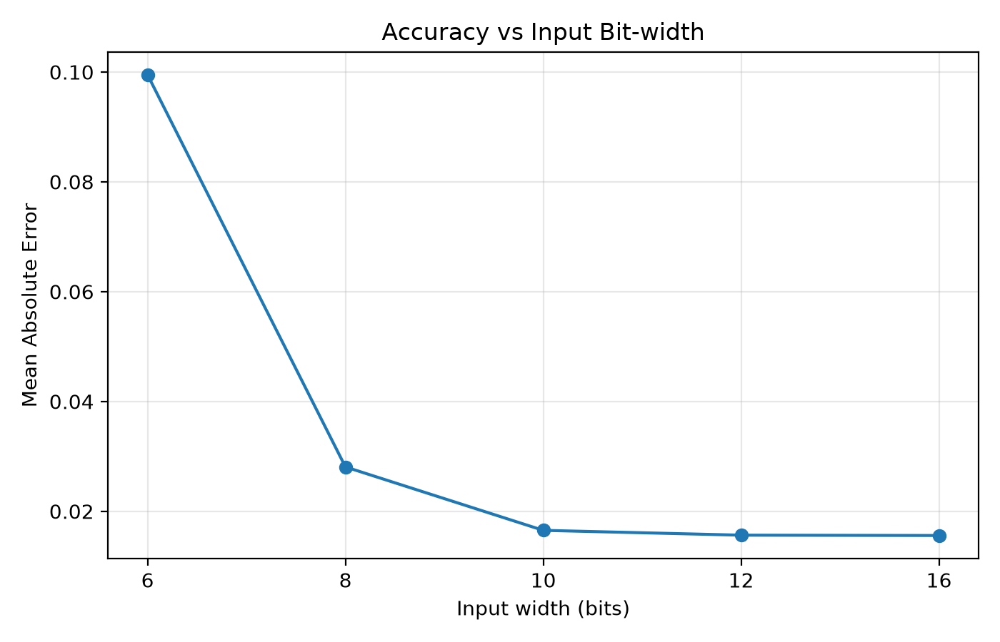
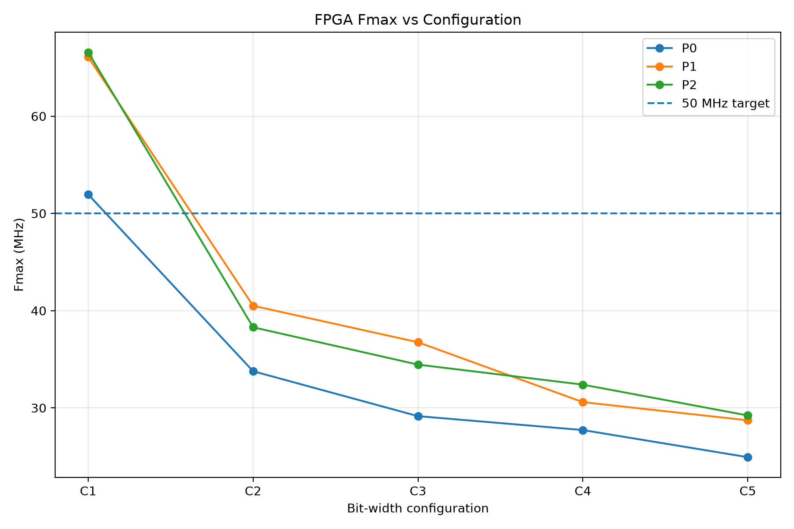
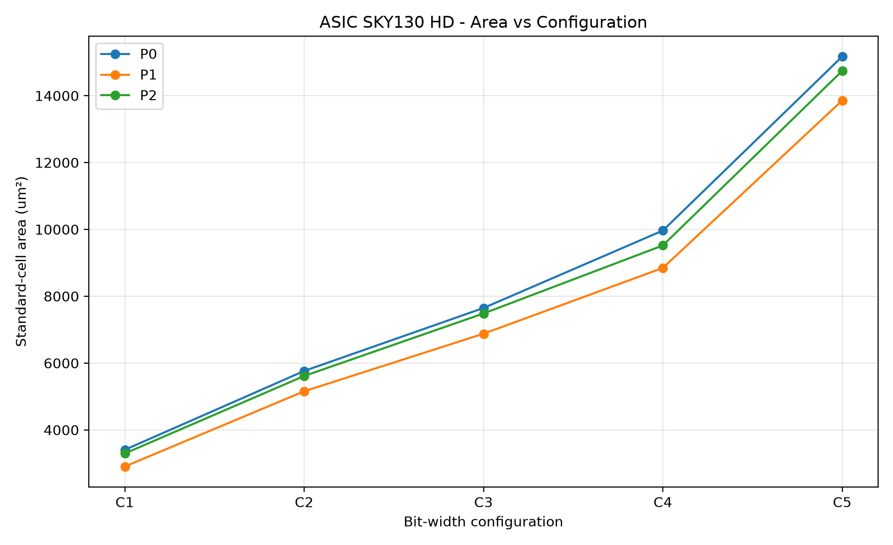
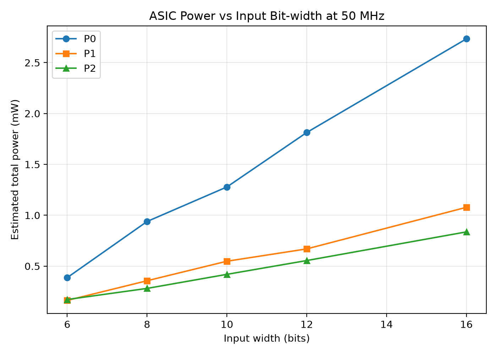
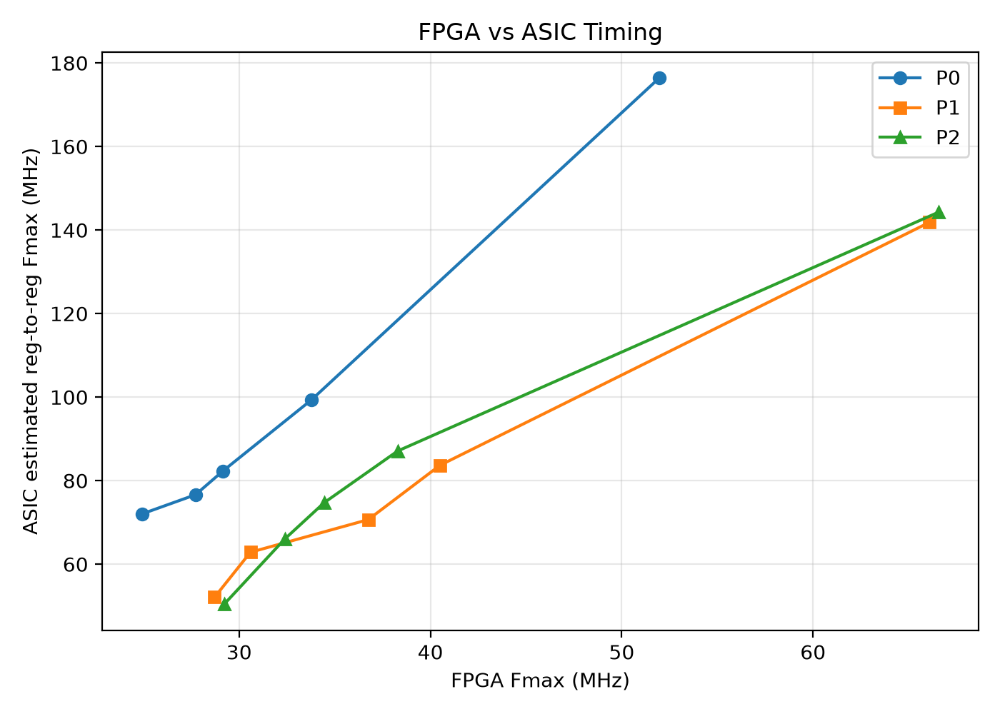
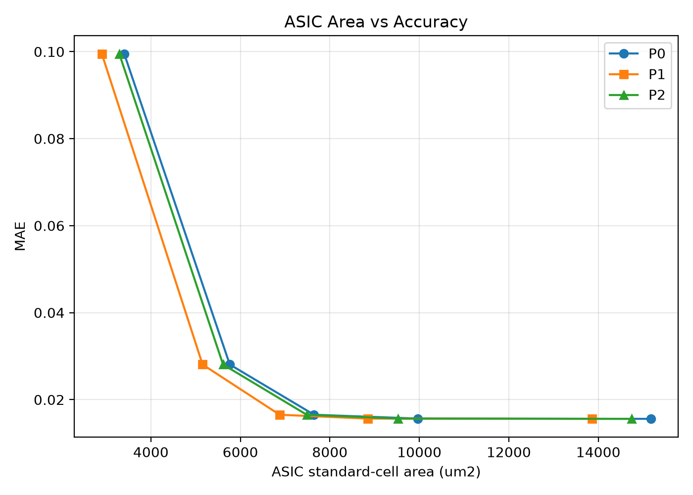
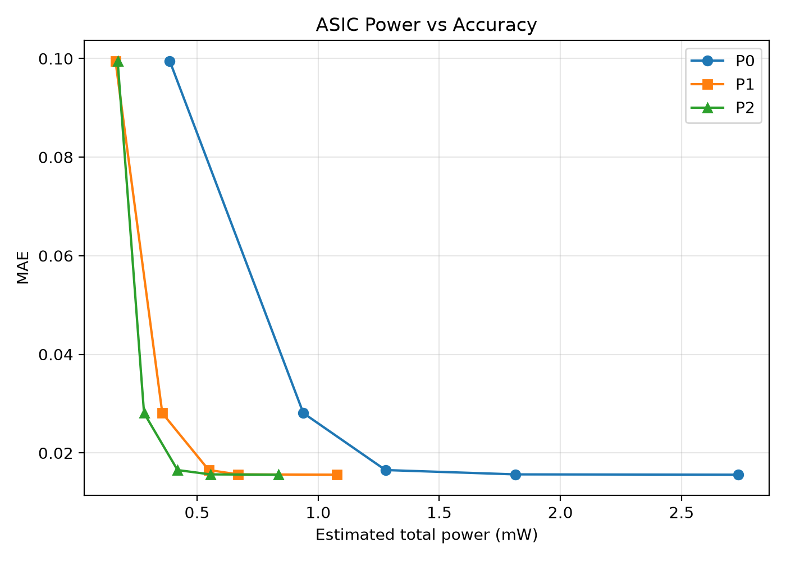
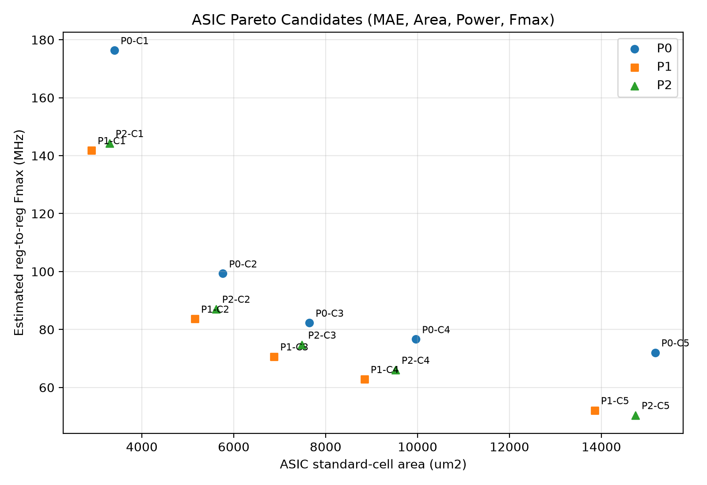

# A9 – Thiết kế và tối ưu datapath Multiply-Accumulate fixed-point cho FPGA và ASIC

**English:** Design and Optimization of a Fixed-Point Multiply-Accumulate Datapath for FPGA and ASIC

## 1. Mục tiêu đề tài

Xây MAC datapath và khảo sát ảnh hưởng của bit-width/pipeline đến accuracy và hardware cost.

### Nội dung lõi

- Reference arithmetic model.
- Multiplier + accumulator + register/pipeline.
- Truncation, rounding, saturation.
- 2+ bit-width/pipeline configurations.
- FPGA/ASIC synthesis và comparison.

### Sản phẩm bắt buộc

- Golden model.
- Parameterized RTL MAC.
- Verification vectors.
- PPA/Fmax/latency table.
- Numerical error analysis.

## 2. Công cụ và môi trường thực nghiệm

| Công cụ | Mục đích |
|---|---|
| Python 3 | Reference model, golden model và numerical analysis |
| Matplotlib | Biểu đồ phân tích kết quả |
| SystemVerilog | Thiết kế RTL MAC và testbench |
| Icarus Verilog | RTL và gate-level simulation |
| Yosys | Logic synthesis và technology mapping |
| nextpnr | FPGA place-and-route và timing analysis |
| OpenSTA | ASIC static timing analysis và power estimation |
| SKY130 HD Liberty | ASIC standard-cell library |
| Ubuntu/WSL | Môi trường phát triển và thực nghiệm |
| Docker | Môi trường chạy OpenSTA |

## 3. Đặc tả số học fixed-point

Cấu hình tham chiếu ban đầu:

| Thành phần | Width (bit) | Fixed-point format |
|---|---:|---|
| Input | 8 | Q4.4 |
| Product | 16 | Q8.8 |
| Accumulator | 24 | Q16.8 |
| Output | 8 | Q4.4 |

Chính sách số học mặc định:

- Signed fixed-point arithmetic.
- Rounding: nearest, ties away from zero.
- Accumulator overflow: saturate_each_step.
- Input/output conversion: saturation.

Ngoài cấu hình tham chiếu, các thực nghiệm sử dụng nhiều
độ rộng bit và cách phân bổ fractional bits khác nhau.

## 4. Cấu hình bit-width

| Config | Input width | Input frac | Product width | Product frac | Acc width | Acc frac |
|---|---:|---:|---:|---:|---:|---:|
| C1 | 6 | 2 | 12 | 4 | 15 | 4 |
| C2 | 8 | 4 | 16 | 8 | 19 | 8 |
| C3 | 10 | 6 | 20 | 12 | 23 | 12 |
| C4 | 12 | 8 | 24 | 16 | 27 | 16 |
| C5 | 16 | 12 | 32 | 24 | 35 | 24 |

Output được giữ cố định ở Q4.4 trong bit-width sweep.

Cấu hình C2 sử dụng accumulator 19 bit trong thực nghiệm,
khác với accumulator 24 bit của cấu hình tham chiếu ban đầu.

## 5. Kiến trúc MAC

Ba kiến trúc RTL được triển khai để khảo sát ảnh hưởng
của pipeline đến tài nguyên phần cứng và hiệu năng.

| Architecture | RTL | Latency | II |
|---|---|---:|---:|
| P0 | [mac_parameterized.sv](rtl/mac_parameterized.sv) | 1 cycle | 1 |
| P1 | [mac_pipeline.sv](rtl/mac_pipeline.sv) | 2 cycles | 1 |
| P2 | [mac_pipeline2.sv](rtl/mac_pipeline2.sv) | 3 cycles | 1 |

### P0 – Parameterized MAC

Không bổ sung tầng pipeline trung gian.

Multiplier, rescale, accumulation và xử lý đầu ra
được thực hiện theo datapath cơ sở.

### P1 – MAC with one additional pipeline stage

Bổ sung thanh ghi lưu kết quả product đã rescale
trước accumulation.

### P2 – MAC with two additional pipeline stages

Bổ sung tầng thanh ghi đầu vào trước multiplication,
kết hợp với thanh ghi product trước accumulation.

Cả ba kiến trúc hỗ trợ:

- Parameterized input, accumulator và output widths.
- Parameterized fractional bits.
- Signed multiplication.
- Accumulation.
- Rounding và saturation.
- Reset, clear_acc, valid_in và valid_out.

Tổng số cấu hình khảo sát:

**5 bit-width configurations × 3 pipeline architectures = 15 configurations.**

## 6. Reference model và verification

### Reference arithmetic model

- [numeric_spec.py](python/numeric_spec.py)
- [golden_model.py](python/golden_model.py)
- [verify_results.py](python/verify_results.py)

Floating-point reference model được sử dụng làm
tham chiếu để đánh giá sai số số học.

Fixed-point golden model mô phỏng quá trình lượng tử hóa,
nhân, rescale, tích lũy, rounding và xử lý overflow.

### Verification

- Self-checking SystemVerilog testbenches.
- RTL equivalence với Python golden model.
- Boundary verification.
- Streaming pipeline verification.
- ASIC mapped gate-level verification.

Các testbench chính:

- [mac_python_equivalence_tb.sv](tb/mac_python_equivalence_tb.sv)
- [mac_pipeline_equivalence_tb.sv](tb/mac_pipeline_equivalence_tb.sv)
- [mac_pipeline_stream_tb.sv](tb/mac_pipeline_stream_tb.sv)
- [mac_pipeline2_stream_tb.sv](tb/mac_pipeline2_stream_tb.sv)
- [mac_boundary_tb.sv](tb/mac_boundary_tb.sv)

### Kết quả kiểm chứng

| Architecture | Configurations | Vectors/config | Result |
|---|---:|---:|---|
| P0 | 5 | 655 | PASS |
| P1 | 5 | 655 | PASS |
| P2 | 5 | 655 | PASS |

- RTL verification: 15/15 configurations PASS.
- ASIC gate-level verification: 15/15 configurations PASS.
- Không ghi nhận sai khác với expected results trong
  các bộ vector kiểm chứng tương ứng.

Verification vectors và kết quả mô phỏng được lưu
trong `vectors/` và `results/`.

## 7. Numerical error analysis

Các chỉ số đánh giá:

- Mean Absolute Error (MAE).
- Mean Squared Error (MSE).
- Root Mean Squared Error (RMSE).
- Maximum Absolute Error.

### 7.1. Bit-width sweep

| Config | Input width | MAE | RMSE | Max Error |
|---|---:|---:|---:|---:|
| C1 | 6 | 0.099481 | 0.124487 | 0.447918 |
| C2 | 8 | 0.028077 | 0.035279 | 0.114582 |
| C3 | 10 | 0.016526 | 0.019580 | 0.049307 |
| C4 | 12 | 0.015649 | 0.018126 | 0.036253 |
| C5 | 16 | 0.015588 | 0.018021 | 0.031324 |



Kết quả cho thấy tăng bit-width làm giảm sai số số học.

Mức cải thiện độ chính xác giảm dần từ C3 đến C5
khi output vẫn được giữ cố định ở Q4.4.

Nguồn dữ liệu:
[bitwidth_sweep.csv](results/bitwidth_sweep.csv).

### 7.2. Fractional-bit allocation

Input width được giữ cố định ở 8 bit,
accumulator width là 24 bit với 8 fractional bits.

| Config | Input format | Fractional bits | MAE | RMSE |
|---|---|---:|---:|---:|
| F1 | Q6.2 | 2 | 0.099481 | 0.124487 |
| F2 | Q5.3 | 3 | 0.050990 | 0.064005 |
| F3 | Q4.4 | 4 | 0.028077 | 0.035279 |
| F4 | Q3.5 | 5 | 0.019685 | 0.024173 |
| F5 | Q2.6 | 6 | 0.016755 | 0.019942 |

Tăng fractional bits cải thiện độ phân giải và giảm
sai số trong tập dữ liệu khảo sát, đồng thời làm giảm
phạm vi biểu diễn của input.

Nguồn dữ liệu:
[fractional_sweep.csv](results/fractional_sweep.csv).

### 7.3. Rounding và truncation

| Rounding mode | MAE | RMSE | Max Error |
|---|---:|---:|---:|
| Truncate | 0.084635 | 0.100023 | 0.293219 |
| Nearest, ties away from zero | 0.028077 | 0.035279 | 0.114582 |

Rounding giảm MAE khoảng 66.83% so với truncation
trong tập dữ liệu thực nghiệm gồm 1000 mẫu.

Nguồn dữ liệu:
[rounding_sweep.csv](results/rounding_sweep.csv).

### 7.4. Overflow và saturation

| Experiment | Mode | MAE | Max Error |
|---|---|---:|---:|
| Input overflow | Saturate | 1.020833 | 2.0625 |
| Input overflow | Wrap | 10.666667 | 16.0 |
| Accumulator overflow | Saturate | 0 | 0 |
| Accumulator overflow | Saturate each step | 73 | 73 |
| Accumulator overflow | Wrap | 0 | 0 |
| Output overflow | Saturate | 384.031250 | 384.0625 |
| Output overflow | Wrap | 392.000000 | 400.0 |

Saturation giới hạn giá trị tại biên biểu diễn
và hạn chế sai số do wrap-around trong các trường hợp
input/output overflow được khảo sát.

Saturation từng bước tại accumulator có thể làm mất
thông tin tích lũy khi xảy ra overflow. Vì vậy,
accumulator width cần được lựa chọn phù hợp.

Các thực nghiệm overflow là những trường hợp kiểm tra
biên có chủ đích, không đại diện cho mọi workload.

Nguồn dữ liệu:
[overflow_sweep.csv](results/overflow_sweep.csv).

## 8. FPGA synthesis và timing

- Target: Lattice iCE40 HX8K.
- Package: CT256.
- Flow: Yosys + nextpnr.
- Target clock frequency: 50 MHz.

### Kết quả FPGA

| Architecture | Config | LUT4 | FF | Carry | Fmax (MHz) | Timing 50 MHz |
|---|---|---:|---:|---:|---:|---|
| P0 | C1 | 225 | 24 | 51 | 51.95 | PASS |
| P0 | C2 | 435 | 28 | 141 | 33.77 | FAIL |
| P0 | C3 | 580 | 32 | 169 | 29.15 | FAIL |
| P0 | C4 | 777 | 36 | 196 | 27.72 | FAIL |
| P0 | C5 | 1176 | 44 | 252 | 24.93 | FAIL |
| P1 | C1 | 189 | 38 | 61 | 66.08 | PASS |
| P1 | C2 | 388 | 46 | 156 | 40.50 | FAIL |
| P1 | C3 | 550 | 54 | 187 | 36.75 | FAIL |
| P1 | C4 | 708 | 62 | 219 | 30.59 | FAIL |
| P1 | C5 | 1110 | 78 | 282 | 28.72 | FAIL |
| P2 | C1 | 189 | 52 | 61 | 66.57 | PASS |
| P2 | C2 | 388 | 64 | 156 | 38.29 | FAIL |
| P2 | C3 | 541 | 76 | 187 | 34.45 | FAIL |
| P2 | C4 | 697 | 88 | 219 | 32.39 | FAIL |
| P2 | C5 | 1104 | 112 | 282 | 29.22 | FAIL |



P1 và P2 cải thiện Fmax so với P0 tại các cấu hình
bit-width đã khảo sát.

Tăng pipeline depth làm tăng số lượng flip-flops,
trong khi LUT4 và Fmax phụ thuộc vào cấu trúc datapath
và kết quả technology mapping.

Timing FAIL biểu thị thiết kế chưa đáp ứng ràng buộc
50 MHz, không phải lỗi kiểm chứng chức năng.

Kết quả chi tiết:
[fpga_ice40_summary.csv](results/fpga_ice40/fpga_ice40_summary.csv).

## 9. ASIC synthesis, STA và Power

- Technology: SKY130 HD.
- Liberty corner: TT.
- Synthesis: Yosys technology mapping.
- Static timing analysis: OpenSTA.
- Target clock frequency: 50 MHz.

### 9.1. ASIC area và timing

| Architecture | Config | Cell count | FF | Area (um2) | Estimated Fmax (MHz) |
|---|---|---:|---:|---:|---:|
| P0 | C1 | 392 | 24 | 3404.52 | 176.37 |
| P0 | C2 | 724 | 28 | 5763.03 | 99.30 |
| P0 | C3 | 951 | 32 | 7647.33 | 82.30 |
| P0 | C4 | 1273 | 36 | 9964.56 | 76.63 |
| P0 | C5 | 2035 | 44 | 15172.05 | 72.05 |
| P1 | C1 | 371 | 38 | 2904.04 | 141.84 |
| P1 | C2 | 697 | 46 | 5154.94 | 83.68 |
| P1 | C3 | 947 | 54 | 6877.85 | 70.67 |
| P1 | C4 | 1255 | 62 | 8845.98 | 62.85 |
| P1 | C5 | 1955 | 78 | 13857.04 | 52.11 |
| P2 | C1 | 397 | 52 | 3294.41 | 144.30 |
| P2 | C2 | 741 | 64 | 5612.88 | 87.11 |
| P2 | C3 | 994 | 76 | 7483.43 | 74.74 |
| P2 | C4 | 1291 | 88 | 9519.13 | 66.05 |
| P2 | C5 | 2007 | 112 | 14742.89 | 50.43 |



ASIC mapped-netlist STA tại chu kỳ clock 20 ns:

- 15/15 configurations đáp ứng setup timing.
- Total Negative Slack (TNS) = 0.
- P1 có standard-cell area nhỏ nhất tại cả năm
  cấu hình bit-width.
- P0 có estimated register-to-register Fmax cao hơn
  P1 và P2 trong các cấu hình khảo sát.

ASIC area là tổng diện tích standard cells,
không phải diện tích physical core.

ASIC Fmax được ước tính từ register-to-register timing
trên mapped netlist, không phải signoff Fmax.

Nguồn dữ liệu:

- [ASIC synthesis summary](results/asic_sky130_filtered/asic_sky130_summary.csv)
- [ASIC timing reports](results/asic_sky130_filtered/timing/)

### 9.2. ASIC Power estimation

Công suất được ước tính bằng OpenSTA trên mapped netlist
với thông tin power từ SKY130 HD Liberty.

Điều kiện thực nghiệm:

| Parameter | Value |
|---|---|
| Clock frequency | 50 MHz |
| Data input activity | 0.1 |
| Data input duty | 0.5 |
| valid_in | Active |
| Reset | Inactive |
| Method | Vectorless pre-layout |

Các thành phần công suất:

- Internal power.
- Switching power.
- Leakage power.
- Total power.

### Kết quả Total Power

Đơn vị: mW.

| Config | P0 | P1 | P2 |
|---|---:|---:|---:|
| C1 | 0.387284 | 0.163406 | 0.172210 |
| C2 | 0.938721 | 0.356497 | 0.281139 |
| C3 | 1.278021 | 0.548259 | 0.419408 |
| C4 | 1.813159 | 0.669364 | 0.554990 |
| C5 | 2.733248 | 1.077934 | 0.836512 |



Trong điều kiện switching activity và clock frequency
đã chọn, P1 và P2 có estimated total power thấp hơn P0.

P1 có công suất thấp nhất tại C1.
P2 có công suất thấp nhất tại C2–C5.

Kết quả là công suất ước tính trước physical implementation,
không phải công suất đo thực tế.

Nguồn dữ liệu:

- [ASIC Power summary](results/asic_sky130_filtered/power/asic_power_summary.csv)
- [ASIC Power reports](results/asic_sky130_filtered/power/)

## 10. PPA/Fmax/latency comparison

Bảng tổng hợp 15 cấu hình bao gồm:

- Numerical error: MAE, MSE, RMSE, Max Error.
- FPGA resources: LUT4, FF, Carry.
- FPGA Fmax và timing status.
- ASIC standard-cell count và area.
- ASIC estimated internal, switching, leakage và total power.
- ASIC setup slack và estimated register-to-register Fmax.
- Latency và initiation interval.

Bảng kết quả:
[ppa_summary.csv](results/ppa_summary.csv).

### 10.1. Latency và throughput

| Architecture | Latency (cycles) | II (cycles) |
|---|---:|---:|
| P0 | 1 | 1 |
| P1 | 2 | 1 |
| P2 | 3 | 1 |

Throughput lý thuyết:

$$
Throughput = \frac{F_{clk}}{II}
$$

Latency theo thời gian:

$$
Latency = \frac{Latency_{cycles}}{F_{clk}}
$$

P1 và P2 tăng latency theo số chu kỳ nhưng vẫn duy trì
II = 1, cho phép tiếp nhận một bộ toán hạng mỗi chu kỳ
trong điều kiện streaming liên tục.

### 10.2. FPGA và ASIC comparison



Kết quả khảo sát cho thấy hiệu quả của pipeline phụ thuộc
vào công nghệ triển khai và cấu trúc datapath.

Pipeline cải thiện Fmax trên FPGA iCE40 trong các cấu hình
khảo sát, nhưng không làm tăng estimated register-to-register
Fmax trên ASIC SKY130 HD so với P0.

FPGA Fmax và ASIC Fmax được xác định bằng các flow khác nhau,
do đó cần xem xét điều kiện thực nghiệm khi so sánh.

### 10.3. Accuracy và hardware cost





Tăng bit-width làm giảm numerical error nhưng đồng thời
làm tăng tài nguyên FPGA, ASIC area và estimated power.

Mức cải thiện sai số từ C3 đến C5 nhỏ hơn đáng kể
so với mức cải thiện từ C1 đến C3.

### 10.4. Pareto analysis

ASIC Pareto analysis sử dụng bốn tiêu chí:

- Minimize MAE.
- Minimize standard-cell area.
- Minimize estimated total power.
- Maximize estimated register-to-register Fmax.

Kết quả: 15/15 cấu hình không bị chi phối theo
bốn tiêu chí đã chọn.



Biểu đồ biểu diễn hai trục area và Fmax của các ứng viên
được xác định bằng bốn tiêu chí Pareto.

Việc một cấu hình thuộc Pareto frontier không có nghĩa
cấu hình đó tối ưu đối với mọi mục tiêu thiết kế.

Nguồn dữ liệu:
[asic_pareto_summary.csv](results/asic_pareto_summary.csv).

## 11. Optimization recommendation

Các cấu hình được lựa chọn dựa trên sự đánh đổi giữa
độ chính xác, tài nguyên phần cứng, diện tích,
công suất và hiệu năng.

Với điều kiện khảo sát MAE <= 0.02,
có 9/15 cấu hình đáp ứng ngưỡng sai số.

| Objective | Configuration | Result |
|---|---|---:|
| Minimum ASIC area | P1-C3 | 6877.85 um2 |
| Minimum ASIC power | P2-C3 | 0.419408 mW |
| Maximum ASIC estimated Fmax | P0-C3 | 82.30 MHz |
| Maximum FPGA Fmax | P1-C3 | 36.75 MHz |
| Minimum latency cycles | P0-C3/C4/C5 | 1 cycle |
| Minimum MAE | P0/P1/P2-C5 | 0.015588 |

### So sánh các kiến trúc tại C3

| Metric | P0-C3 | P1-C3 | P2-C3 |
|---|---:|---:|---:|
| Input width (bit) | 10 | 10 | 10 |
| Input fractional bits | 6 | 6 | 6 |
| Accumulator width (bit) | 23 | 23 | 23 |
| MAE | 0.016526 | 0.016526 | 0.016526 |
| RMSE | 0.019580 | 0.019580 | 0.019580 |
| FPGA LUT4 | 580 | 550 | 541 |
| FPGA FF | 32 | 54 | 76 |
| FPGA Fmax (MHz) | 29.15 | 36.75 | 34.45 |
| ASIC area (um2) | 7647.33 | 6877.85 | 7483.43 |
| ASIC power (mW) | 1.278021 | 0.548259 | 0.419408 |
| ASIC estimated Fmax (MHz) | 82.30 | 70.67 | 74.74 |
| Latency (cycles) | 1 | 2 | 3 |
| II (cycles) | 1 | 1 | 1 |

P1-C3 là ứng viên cân bằng giữa độ chính xác,
ASIC area và FPGA Fmax trong nhóm cấu hình
đáp ứng MAE <= 0.02.

P2-C3 phù hợp với mục tiêu giảm estimated ASIC power.

P0-C3 phù hợp với mục tiêu giảm latency theo chu kỳ
và tăng estimated ASIC register-to-register Fmax.

Ngưỡng MAE <= 0.02 được sử dụng làm điều kiện khảo sát
lựa chọn cấu hình, không phải ràng buộc chính thức
của đề tài.

Việc lựa chọn kiến trúc phụ thuộc vào các yêu cầu
và ràng buộc cụ thể của ứng dụng.

Kết quả chi tiết:
[optimization_recommendation.csv](results/optimization_recommendation.csv).

## 12. Cấu trúc dự án

```text
A9_MAC_Project/
├── python/
│   ├── numeric_spec.py
│   ├── golden_model.py
│   ├── verify_results.py
│   ├── generate_rtl_vectors.py
│   ├── error_analysis.py
│   ├── bitwidth_sweep.py
│   ├── fractional_sweep.py
│   ├── rounding_sweep.py
│   ├── overflow_sweep.py
│   ├── summarize_asic_power.py
│   ├── build_ppa_summary.py
│   ├── plot_ppa_pareto.py
│   └── select_optimal_config.py
├── rtl/
│   ├── mac_parameterized.sv
│   ├── mac_pipeline.sv
│   └── mac_pipeline2.sv
├── tb/
├── vectors/
├── scripts/
│   ├── run_fpga_ice40_sweep.sh
│   ├── run_asic_sky130_sweep.sh
│   ├── run_asic_p0_equivalence.sh
│   ├── run_asic_p1_equivalence.sh
│   ├── run_asic_p2_equivalence.sh
│   ├── run_asic_sta_sweep.sh
│   ├── run_asic_power_sweep.sh
│   └── sta/
├── liberty/
├── results/
│   ├── fpga_ice40/
│   ├── asic_sky130_filtered/
│   │   ├── timing/
│   │   └── power/
│   ├── ppa_plots/
│   ├── report_figures/
│   ├── bitwidth_sweep.csv
│   ├── fractional_sweep.csv
│   ├── rounding_sweep.csv
│   ├── overflow_sweep.csv
│   ├── ppa_summary.csv
│   ├── asic_pareto_summary.csv
│   └── optimization_recommendation.csv
└── README.md
```

Sơ đồ trên thể hiện các thành phần chính của dự án.

## 13. Hướng dẫn tái lập thực nghiệm

Các lệnh được thực hiện từ thư mục gốc dự án.

### 13.1. Python environment

```bash
python3 -m venv .venv
source .venv/bin/activate
pip install matplotlib
```

### 13.2. Reference model

```bash
python3 python/numeric_spec.py
python3 python/golden_model.py
python3 python/verify_results.py
```

### 13.3. Numerical error analysis

```bash
python3 python/error_analysis.py
python3 python/bitwidth_sweep.py
python3 python/fractional_sweep.py
python3 python/rounding_sweep.py
python3 python/overflow_sweep.py
```

### 13.4. FPGA synthesis và timing

Yêu cầu Yosys, nextpnr-ice40 và các công cụ
hỗ trợ FPGA iCE40.

```bash
bash scripts/run_fpga_ice40_sweep.sh
```

### 13.5. ASIC synthesis

Yêu cầu Yosys và SKY130 HD Liberty tương ứng.

```bash
bash scripts/run_asic_sky130_sweep.sh
```

### 13.6. ASIC gate-level verification

Yêu cầu mapped netlists, standard-cell simulation models
và verification vectors tương ứng.

```bash
bash scripts/run_asic_p0_equivalence.sh
bash scripts/run_asic_p1_equivalence.sh
bash scripts/run_asic_p2_equivalence.sh
```

### 13.7. ASIC static timing analysis

Yêu cầu Docker, OpenSTA, mapped netlists và Liberty.

```bash
bash scripts/run_asic_sta_sweep.sh
```

### 13.8. ASIC Power estimation

```bash
bash scripts/run_asic_power_sweep.sh
python3 python/summarize_asic_power.py
```

### 13.9. PPA, Pareto và optimization

```bash
python3 python/build_ppa_summary.py
python3 python/plot_ppa_pareto.py
python3 python/select_optimal_config.py
```

Các flow synthesis, verification, STA và Power cần
được cấu hình đúng thư viện công nghệ, công cụ,
đường dẫn và dữ liệu đầu vào tương ứng.

Các bảng tổng hợp và biểu đồ đã lưu trong `results/`
có thể được xem trực tiếp mà không cần chạy lại synthesis.

## 14. Giới hạn thực nghiệm

- Numerical error phụ thuộc vào tập dữ liệu,
  độ dài chuỗi MAC và fixed-point format.
- Output được giữ cố định ở Q4.4 trong các khảo sát
  bit-width và fractional bits.
- Rounding, truncation và saturation được so sánh
  về numerical error; chưa có đánh giá hardware cost
  riêng cho từng chế độ.
- FPGA Fmax được xác định từ kết quả place-and-route
  trên iCE40 HX8K.
- ASIC area và timing được đánh giá trên mapped netlist
  với SKY130 HD TT Liberty.
- ASIC Fmax là estimated register-to-register Fmax,
  chưa phải physical signoff Fmax.
- ASIC Power sử dụng vectorless switching activity
  giả định tại 50 MHz, chưa bao gồm đầy đủ ảnh hưởng
  của parasitics và physical implementation.
- Chưa đánh giá FPGA Power.
- P1-C3 chưa đáp ứng timing 50 MHz trên FPGA iCE40.
- Pareto và optimization recommendation phụ thuộc
  vào tập tiêu chí và ràng buộc thiết kế được lựa chọn.

## 15. Kết quả thực hiện

| Nội dung | Kết quả |
|---|---|
| Reference arithmetic model | Floating-point và fixed-point golden model |
| Parameterized RTL MAC | P0, P1 và P2 |
| Bit-width configurations | C1–C5 |
| Fractional-bit configurations | F1–F5 |
| Truncation, rounding, saturation | Numerical error analysis |
| Verification vectors | 655 vectors cho mỗi cấu hình kiểm chứng |
| RTL verification | 15/15 configurations PASS |
| ASIC gate-level verification | 15/15 configurations PASS |
| FPGA synthesis và timing | 15 configurations |
| ASIC synthesis và STA | 15 configurations |
| ASIC Power estimation | 15 configurations |
| PPA/Fmax/latency comparison | Bảng tổng hợp 15 configurations |
| Pareto analysis | MAE, area, power và estimated Fmax |
| Optimization recommendation | Lựa chọn theo từng mục tiêu thiết kế |

Mã nguồn, testbench, verification vectors, synthesis reports,
timing reports, power reports, bảng số liệu và biểu đồ
được lưu trong các thư mục tương ứng của dự án.
